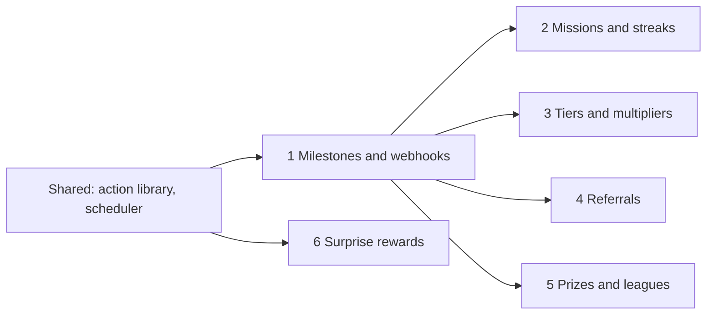

# Motif Gamification Roadmap

**Status:** Design proposal, not implemented · **Scope:** engine, REST API, admin API, console, MCP · **Date:** 27 October 2026

Six capabilities that turn Motif from a system that records progress into one that acts on it: rewarding milestones, building habits, giving status, spreading by word of mouth, making competition winnable, and adding surprise.

## Contents

- [Where Motif stands](#where-motif-stands)
- [Shared building blocks](#shared-building-blocks)
- [1. Milestone events and webhooks](#1-milestone-events-and-webhooks)
- [2. Recurring missions and streaks](#2-recurring-missions-and-streaks)
- [3. Tiers, multipliers and smarter rules](#3-tiers-multipliers-and-smarter-rules)
- [4. Referrals](#4-referrals)
- [5. Leaderboard prizes and leagues](#5-leaderboard-prizes-and-leagues)
- [6. Surprise rewards](#6-surprise-rewards)
- [Decisions needed before building](#decisions-needed-before-building)

## Where Motif stands

Motif covers the basic loop well:

- A product backend sends events.
- Published rules award XP and points into an append-only ledger.
- Missions and achievements count events.
- A reward catalog lets users redeem.
- Leaderboards rank earnings per round.
- Analytics and experiments measure the result.

The gap is that the loop does not close by itself:

- Missions, achievements, levels and streaks award nothing.
- Rules only react to events the customer's backend sends. "Reach level 5, get a free coffee" has to be built by the customer's developer.
- The product has to poll to find out that something happened.

Everything in this document either closes that loop or builds on it.

### Build order

| # | Capability | Pillar | Depends on | Size |
| --- | --- | --- | --- | --- |
| 1 | Milestone events and webhooks | Feedback | Nothing | L |
| 2 | Recurring missions and streaks | Habit, challenge | 1 | L |
| 3 | Tiers, multipliers and smarter rules | Status | 1 | L |
| 4 | Referrals | Social | 1 | M |
| 5 | Leaderboard prizes and leagues | Competition | 1; leagues also use the scheduler | M |
| 6 | Surprise rewards | Unpredictability | Shared action library | M |

Sizes are relative: S is days, M is about one to two weeks, L is two to four weeks. Each includes tests, console screens, MCP tools and docs.



## Shared building blocks

Four pieces are needed by several features. Building them once, first, keeps the six features small and consistent.

### One action library

Rules already have actions (`award_xp`, `award_points`, `log`). Missions, streaks, tiers, referrals, prizes and drops all need to "do something" too. They should all use the same action list, validated by the same code and executed by the same executor inside the worker's transaction. Two new actions join the library:

- `grant_reward` gives a user a catalog reward at no cost, through the existing redemption and delivery path. Needed for prizes, tier perks and referral bonuses.
- `roll_drop` rolls a surprise-reward table (see 6).

### A scheduler in the worker

Several things happen because time passed, not because an event arrived:

- a leaderboard round ends
- a tier review is due
- a streak is about to break
- a referral's hold period is over

The worker gets one scheduler loop that claims due jobs with `FOR UPDATE SKIP LOCKED`, so several workers can run without doing a job twice. Each job is idempotent and safe to retry.

### Deterministic idempotency keys

The ledger already rejects a reused idempotency key. Every automatic award derives its key from what caused it, so retries and redeliveries can never award twice:

```text
mission:{mission_id}:{user}:{period_start}
streak:{streak_key}:{user}:milestone:{days}
prize:{round_id}:{user}
referral:{referral_id}:referrer
drop:{roll_id}
```

### Plan limits, scopes and MCP

- **Plan limits.** Each new resource gets an entitlement (for example `max_webhook_endpoints`, `max_streaks`) so the starter plan stays bounded.
- **Scopes.** New REST writes need the `write` scope of an access key.
- **MCP.** Each feature ships with MCP tools and a docs topic. The MCP boundaries doc is updated whenever a boundary is removed.

## 1. Milestone events and webhooks

**Pillar:** Feedback · **Foundation for:** 2–5 · **Size:** L

> **In one paragraph.** When something meaningful happens inside Motif, such as a level reached or a mission completed, Motif emits its own event. Rules can react to it, and the customer's app is told about it right away through a signed webhook.

### Why

Feedback is the pillar that makes every other mechanic feel real: the confetti when a level is reached, the push notification when a streak is at risk. Today Motif knows the moment a user levels up, but nothing can react to it, and the product only finds out by polling.

> **Café example.** A rule says "when a user reaches level 5, grant a free coffee". The café app receives `motif.level.reached` within a second and shows a celebration screen.

### Milestone events

Motif writes these into the same events table and outbox as customer events, in the same transaction as the state change, so they are emitted exactly once.

- **Reserved prefix.** Their type starts with `motif.`, a prefix customers cannot send.
- **Built-in contracts.** Each has a read-only event contract, so rules can use conditions on its payload.

| Event | Payload | Emitted when |
| --- | --- | --- |
| `motif.level.reached` | level id, level number, total XP | An XP award crosses a level threshold |
| `motif.mission.completed` | mission id, period start | A mission reaches its target |
| `motif.achievement.unlocked` | achievement id | An achievement unlocks |
| `motif.reward.redeemed` | reward id, redemption id, status | A redemption is fulfilled or fails |
| `motif.round.ended` | leaderboard key, round number, top 10 | A round's end time passes, or it is ended by hand |
| `motif.streak.*`, `motif.tier.changed`, `motif.referral.qualified` | See sections 2–4 | Added by those features |

The external event id is derived from the cause, for example `motif:level:{user}:{level_id}`, so a retried transaction cannot emit twice.

#### Loop protection

A rule on `motif.level.reached` could award XP, which could reach another level. Each event carries a causation depth. Motif stops processing at depth 3 and records why in the event trace. Since each level, mission and achievement fires once per user, real chains are short.

#### Ending rounds on time

Rounds currently end implicitly: a round past its `ends_at` simply stops counting. A `finalized_at` column and a scheduler job close each ended round exactly once: they freeze its final standings and emit `motif.round.ended`. Section 5 builds prizes on this.

### Webhooks

A workspace registers endpoints per environment and picks the event types each one receives: milestone events, and optionally its own customer events.

- **Signing.** Each delivery carries two headers:
  - `Motif-Signature: t={timestamp},v1={hmac}`, an HMAC-SHA256 of `{timestamp}.{body}` with the endpoint's secret.
  - `Motif-Event-Id`, for deduplication.

  The secret is encrypted at rest with the existing reward-provider encryption key and shown once.
- **Delivery.** The worker delivers with a 10-second timeout and retries with exponential backoff for up to 24 hours. Delivery order is not guaranteed; payloads carry timestamps.
- **Safety.** In production, URLs must be HTTPS and must not resolve to private or loopback addresses. This is checked at delivery time, not just when the URL is saved.
- **Health.** An endpoint that fails continuously for 3 days is paused, and the console shows why.

### API

| Route | Purpose |
| --- | --- |
| `GET/POST /v1/admin/webhooks` | List and create endpoints |
| `PATCH/DELETE /v1/admin/webhooks/{id}` | Change event types, pause, delete |
| `POST /v1/admin/webhooks/{id}/test` | Send a signed sample event |
| `GET /v1/admin/webhooks/{id}/deliveries` | Recent deliveries with status code and attempts |
| `POST /v1/admin/webhooks/deliveries/{id}/redeliver` | Send one delivery again |

**Console:**
- A Webhooks page under Workspace with endpoints, a delivery log and "Send test".
- Rule editors list milestone events alongside the workspace's own event types.

**MCP:**
- Rules can be drafted on milestone events.
- The MCP server can list webhooks and send a test, but cannot read secrets.

### Out of scope

Sending email, SMS or push. Motif tells the product; the product decides how to reach the user.

### Open questions

- **Custom events from rules?** Should a rule be able to emit a named custom event (an `emit_event` action) for the product's webhooks? Useful, but it lets rules build arbitrary chains. Proposal: later.

## 2. Recurring missions and streaks

**Pillars:** Habit, challenge · **Needs:** 1 · **Size:** L

> **In one paragraph.**
> - **Missions** that reset every day, week or month, can have several steps, and pay out on completion.
> - **Streaks** that are configured as resources, count days in the workspace's timezone, reward milestones, and can be protected with freezes bought with points.

### Why

Retention comes from routines. "Three orders this week" brings a customer back every week, and a 30-day streak is something people protect. Today:

- A mission is "count N events of one type, forever".
- A streak is a read-only number counted in UTC days, which for Tehran rolls over at 03:30.

> **Café example.**
> - A weekly mission, "Try 3 different drinks", resets every Saturday at midnight Tehran time and pays 50 coins.
> - A 7-day check-in streak pays a free pastry.
> - A customer about to lose a 20-day streak can spend 30 coins on a freeze.

### Missions

Missions keep today's shape and gain optional fields:

| Field | Values | Meaning |
| --- | --- | --- |
| `reset` | `never`, `day`, `week`, `month`, with timezone and week start | Progress is kept per period. Reuses the leaderboard schedule and window code. |
| `measure` | `count`, `sum` of a payload path, `distinct` values of a path | "3 orders", "spend 500,000 in total", "3 different drinks" |
| `filter` | Rule-language conditions | Only matching events count, such as orders over 100,000 |
| `steps` | Ordered or unordered list of event type, filter, target | Multi-step quests: "order a drink, then leave a review" |
| `on_complete` | Action list | Paid once per user per period, with key `mission:{id}:{user}:{period}` |
| `available` | Start and end time | Limited-time challenges, such as a Nowruz week |

- **Storage.** Progress moves to a `mission_progress` table keyed by mission, user and period start.
- **Distinct values.** `distinct` keeps the distinct values seen per period, capped at the target.
- **History.** Old periods are kept for 90 days, then summarized.
- **API.** `GET /v1/users/{id}/missions` adds the period, `resets_at` and per-step progress.

### Streaks

Streaks become a resource (`/v1/admin/streaks`) instead of a query by event type.

- **Definition.** Each streak has:
  - a key, an event type and a filter
  - a period: `day` or `week`
  - a timezone
  - milestones, such as `[{"count": 7, "actions": [...]}]`
  - freeze settings: maximum held, price in a currency, auto-use
- **State.** A `streak_state` row per user and streak holds the current and longest count, the last active period and freezes held. It is updated in the worker's transaction on each qualifying event, instead of being recomputed from the events table on every read.
- **Breaking is lazy.** No job runs at midnight for every user. On the next qualifying event:
  - If the user holds enough freezes to cover the missed periods, one is spent per period and the streak continues.
  - Otherwise the streak restarts at 1.

  Reads compute `active`, `at_risk` (today not done yet) or `broken` against the current time, without writing.
- **Events.** `motif.streak.extended`, `motif.streak.milestone`, `motif.streak.frozen`, `motif.streak.reset`.
- **At-risk reminders (phase 2).** A scheduler job emits `motif.streak.at_risk` a few hours before the period ends, for users with a streak of at least N who have not acted yet. That gives the product a reliable push trigger.

#### Freezes as a points sink

`POST /v1/users/{id}/streaks/{key}/freezes`, with an idempotency key, spends the configured price through the ledger and adds a freeze, up to the maximum held. Points that can be spent on something meaningful keep their value.

The existing `GET /v1/users/{id}/streaks?event_type=` stays for compatibility and keeps counting UTC days.

### Open questions

- **Streak repair?** Allow buying back a broken streak within 24 hours, at a higher price? Duolingo does. Proposal: phase 2.
- **Mission history retention?** 90 days is a guess, and it affects storage on busy workspaces.

## 3. Tiers, multipliers and smarter rules

**Pillar:** Status · **Needs:** 1 · **Size:** L

> **In one paragraph.**
> - **Loyalty tiers**, earned within a qualifying window and kept or lost at review, with perks such as point multipliers.
> - **Boosts**: time-boxed multipliers.
> - **Smarter rules** that can see who the user is.
> - **Caps** on how often a rule pays one user.

### Why

- Levels only go up, so they stop motivating once reached. Tiers are earned again every period: the fear of dropping from Gold to Silver is what keeps a regular coming back.
- Multipliers make the tier tangible at every purchase.
- Today a rule cannot tell a first-time customer from a Gold member unless the customer's backend computes it and sends it in the payload.

> **Café example.**
> - Silver needs 2,000 coins earned in 90 days; Gold needs 6,000.
> - Gold members earn ×1.5 coins on every order.
> - Every Friday, coins are doubled.
> - A Gold member who earns less than 4,000 in the next 90 days moves down to Silver.

### Tier programs

- **One program per environment.** An ordered list of tiers; the first is the default.
- **Each tier sets:**
  - a qualify threshold
  - a lower retain threshold, so members don't flip back and forth at the boundary
  - perks: multipliers per currency, and a free-form `benefits` object the product renders ("free upsize")
- **The metric** is points earned in one currency, XP earned, or a count of matching events. It is measured over a rolling window (for example 90 days) or a calendar period (for example a year).
- **Upgrades are immediate,** in the same transaction as the award that crosses the threshold, like leaderboard scoring today.
- **Downgrades happen at review time.** Each member has a `review_at`. A scheduler job re-evaluates due members and moves them down at most one tier per review.
- **Events.** Both directions emit `motif.tier.changed`.

Rolling windows need daily buckets (`tier_metric_days`: user, day, amount), so the window sum is one indexed query. The scheduler deletes buckets older than the window.

### Multipliers and boosts

- **Tier multiplier.** Applies to `award_points` actions from rules, missions and streaks. It does not apply to direct transactions through the REST API, where the customer's backend chose the amount.
- **Boost.** A time-boxed multiplier with a currency, a factor, a schedule window and an optional tier filter.
- **Stacking.** The tier multiplier times the largest active boost, capped at ×5. Amounts round down.
- **Audit trail.** The ledger entry's provenance records the base amount and every factor applied, so support can explain any balance.

### Rules that see the user

Conditions gain a read-only `$user` scope, loaded once per event:

```json
{"all": [
  {"eq":  ["$user.tier", "gold"]},
  {"gte": ["$user.level", 5]},
  {"eq":  ["$user.first_event", true]},
  {"gte": ["$.total", 100000]}
]}
```

Available fields:

| Field | Meaning |
| --- | --- |
| `tier`, `level`, `xp` | The user's current tier, level and total XP |
| `points.{currency}` | The user's balance in a currency |
| `first_event` | True for the user's first accepted event of this type |
| `count.{event_type}` | Lifetime count of an event type, from the counters achievements already keep |

`check_rule` accepts a sample user alongside the sample payload.

### Caps

A rule can set `limit: {"per_user": 1, "per": "day"}`; `per` also accepts `week`, `month` and `lifetime`.

- A counter row per rule, user and period is incremented in the same transaction as the award.
- When the cap is reached, the rule is skipped and the event trace says so.

This is the basic protection against a looping client or an abusive user.

### Open questions

- **Multipliers on direct transactions?** Proposal: no, but allow a per-request opt-in flag.
- **Grace period?** Should a downgrade wait for a short grace period after `review_at`, with an at-risk event first? It is kinder, and gives the product a nudge to send.

## 4. Referrals

**Pillar:** Social · **Needs:** 1 · **Size:** M

> **In one paragraph.** Every user gets a referral code. When a new user signs up with it and then does something that counts, like a first paid order within 30 days, both people are rewarded once, with caps and a hold period against abuse.

### Why

Everything else in Motif is single-player. Referrals are the social mechanic with the clearest business value: they bring in new customers, and the customer who refers becomes more committed too.

> **Café example.**
> 1. Sara shares her code.
> 2. Ali signs up with it and pays for his first order within 30 days.
> 3. After a 7-day hold, Sara gets 200 coins and Ali gets a free drink.

### How it works

- **Program per environment.** A program sets:
  - the qualifying event and filter, for example `order.completed` where `$.payment_status` is `paid`
  - the qualify window, for example 30 days after attribution
  - the hold period
  - the referrer's actions and the referee's actions
  - caps per referrer, per month and lifetime
- **Codes.** Created on first request: 8 characters without look-alike letters, unique per environment. Custom codes ("SARA") are allowed if unused.
- **Attribution.** The product calls `POST /v1/referrals` with the new user's id and the code. A user can be referred once: the first attribution wins, and repeats return the same result.
- **Qualification.** The worker checks the referee's events against the program.
  - The first match within the window marks the referral *qualified*.
  - After the hold, a scheduler job pays both sides, with keys `referral:{id}:referrer` and `referral:{id}:referee`.
  - Emits `motif.referral.qualified` and `motif.referral.rewarded`.
- **Rejection.** During the hold, the product can call `POST /v1/referrals/{id}/reject` (refund, chargeback, fraud), and no reward is paid.

#### Guards Motif enforces

- No self-referral.
- No attribution for a user who already had accepted events before it, so existing customers can't be "referred". Each workspace can switch this off.
- Per-referrer caps.
- The hold period.

Device, phone and IP checks stay in the product, consistent with the current boundary that anti-abuse decisions belong to the product.

### API

| Route | Purpose |
| --- | --- |
| `GET /v1/users/{id}/referral` | The user's code and counts: invited, qualified, pending, rewarded |
| `POST /v1/referrals` | Attribute a new user to a code |
| `POST /v1/referrals/{id}/reject` | Cancel during the hold |
| `GET/PUT /v1/admin/referral-program` | Configure the program |

**Console:** a Referrals page with the program settings, a funnel (attributed → qualified → rewarded → rejected) and top referrers.

### Open questions

- **Referral leaderboard?** "Top referrers this month" needs leaderboards that rank counts, not only earnings. Worth adding later as a leaderboard metric.

## 5. Leaderboard prizes and leagues

**Pillar:** Competition · **Needs:** 1 · **Size:** M

> **In one paragraph.**
> - **Prizes** paid automatically to the top ranks when a round ends.
> - **Leagues** that split players into small groups by division, with promotion and relegation each round, so everyone competes with people at their level.

### Why

- Today a round ends and nothing happens. The café has to look up the winners and reward them by hand.
- On a board with thousands of players, the user ranked 4,000th has no reason to try. Ranked 4th out of 30 in their league, they do.

### Prizes

- **Configuration.** A board gets `prizes`: a list of rank ranges with actions, such as `{"ranks": "1", "actions": [...]}` and `{"ranks": "2-3", ...}`. Optionally `top_percent`, and a minimum score to be eligible.
- **Payout.** Prizes are paid when the round is finalized (section 1), whether it ended on time or by hand, with key `prize:{round_id}:{user}`.
- **Ties.** Ranks are already unique: ties break on who reached the score first.
- **During the round.** Standings show the prize next to each eligible entry, so the product can display "Top 3 win a free cake".
- **Events.** Emits `motif.leaderboard.prize_awarded`.

### Leagues

A league is a recurring board with a `league` setting:

- **divisions**, such as Bronze, Silver, Gold and Diamond
- **group size**, for example 30
- **how many promote and demote** each round

How a league runs:

- **Lazy placement.** A user is placed in a group the first time they score in a round, in their current division. Groups fill to size before a new one opens, so groups contain only active players. Placement runs under a lock per round and division.
- **Finalization.** At round end:
  - The top N in each group move up a division.
  - The bottom M move down.
  - Players who joined but scored zero move down.
  - New users start in the lowest division.
- **Prizes.** League prizes apply per group, for example to the top 3 of every group.
- **Reads.** `GET /v1/leaderboards/{key}/groups/mine?user_id=` returns the user's division, their group's standings, and the promotion and demotion lines. The console shows every group.

### Open questions

- **Inactive players.** Should a player who skips a whole round drop a division, or keep it? Proposal: keep it for one round, then demote.

## 6. Surprise rewards

**Pillar:** Unpredictability · **Needs:** the shared action library · **Size:** M

> **In one paragraph.** Drop tables with weighted outcomes, optional limited stock, and published odds. A rule can roll one ("1 in 10 orders gets a free pastry"), or a user can open one through the API, which is what a spin-the-wheel or mystery-box screen calls.

### Why

Every reward Motif gives today is fixed and predictable, and predictable rewards stop being exciting. A small chance of something good keeps people engaged long after fixed rewards stop working.

> **Café example.** After every paid order, the order rolls this table, and the app shows a scratch card with the result the API returned:
>
> | Chance | Outcome |
> | --- | --- |
> | 1% | Free drink for a week (stock: 5 per month) |
> | 9% | Free pastry |
> | 30% | 20 bonus coins |
> | 60% | Nothing |

### How it works

- **Drop table.** A key, outcomes with a weight and actions (an empty action list means "nothing"), optional stock per outcome per period, and an optional per-user cap.
- **Triggers.**
  - The `roll_drop` rule action.
  - `POST /v1/users/{id}/drops/{key}/open`, with an idempotency key and an optional price in a currency.
- **Server-side randomness.** Rolls use `crypto/rand` on the server. The outcome is decided and stored (`drop_rolls`) before the actions run, so a retry with the same key returns the same outcome instead of rolling again.
- **Stock.** Decremented in the same transaction. An outcome that is out of stock is removed from the roll, and its weight is spread proportionally over the rest.
- **Transparency.** `GET /v1/drops/{key}` returns the current odds, so the product can show them. Some jurisdictions require this.
- **Reporting.** The console shows expected versus actual payout per outcome, so a misconfigured table is caught early.

#### Compliance

A paid chance at a prize can count as gambling.

- Drops can be priced only in currencies users earn, never in currencies bought with money. The console says so where the price is set.
- Drops sit behind a plan entitlement, so they can be switched off per workspace.

### Open questions

- **Pity timer?** Guarantee a top outcome after N rolls without one? It feels fairer, but makes the odds harder to explain. Proposal: optional, off by default.

## Decisions needed before building

| Decision | Proposal |
| --- | --- |
| Build order | 1 → 2 → 3 → 4 → 5 → 6, with the shared action library and scheduler first |
| Rules emitting custom events | Later, after milestone events prove out |
| Multipliers on direct REST transactions | Off, with a per-request opt-in |
| Streak repair | Phase 2 |
| Leaderboards ranking counts (referrals, visits) | Yes, as a later leaderboard metric |
| Drop tables priced in currencies | Earned currencies only; behind a plan entitlement |
| Which features are in the starter plan | Open: a product and pricing call |

Nothing in this document is implemented. Each feature will get its own migration, tests, console screens, MCP tools and docs when it is built.
